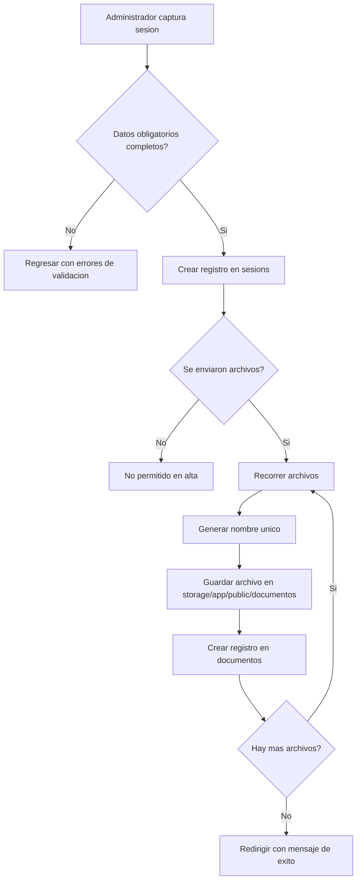
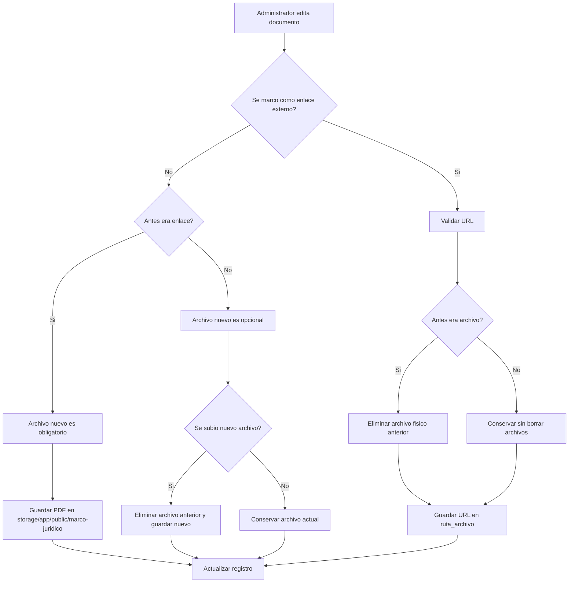
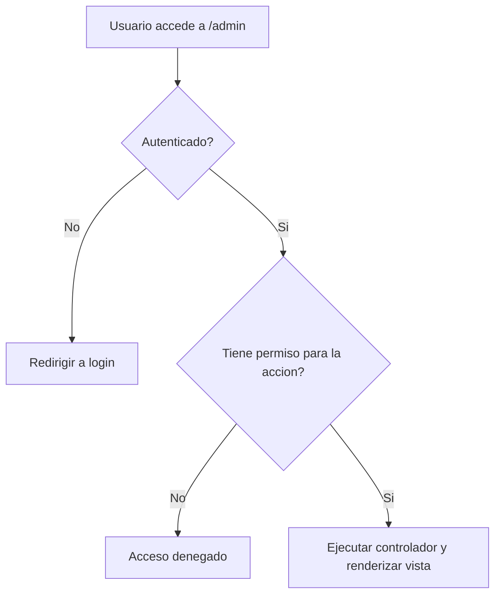

# CEIGEP

Sistema web del Comite Estatal de Informacion Estadistica y Geografica de Puebla (CEIGEP) construido con Laravel 12. Publica contenido institucional, historico de sesiones, marco juridico y documentos de consulta; ademas incluye un panel administrativo con control de acceso por roles y permisos.

## 1. Objetivo del proyecto

Este proyecto resuelve dos necesidades principales:

1. Sitio publico para consulta ciudadana e institucional.
2. Panel privado para administrar usuarios, roles, sesiones y documentos.

La aplicacion permite:

- Mostrar en la pagina principal las ultimas 4 sesiones publicadas.
- Publicar documentos agrupados en la seccion `Acerca`.
- Publicar documentos y enlaces externos en la seccion `Marco Juridico`.
- Registrar y administrar sesiones del CEIGEP con multiples documentos por sesion.
- Administrar usuarios y roles del sistema.
- Registrar una encuesta simple de satisfaccion del sitio.

## 2. Stack tecnologico

- PHP `^8.2`
- Laravel `^12.0`
- Laravel UI `^4.6`
- MySQL o MariaDB
- Spatie `laravel-permission` para roles y permisos
- Laravel Mix `^6`
- Bootstrap `^5.1.3`
- Node.js y npm para compilacion de assets

## 3. Arquitectura general

La aplicacion esta dividida en tres capas funcionales:

- Capa publica: muestra informacion institucional y documentos descargables.
- Capa administrativa: CRUD de catalogos y contenido.
- Capa de persistencia: MySQL/MariaDB + almacenamiento de archivos en `storage/app/public`.

### Modulos principales

| Modulo | Tipo | Responsable | Funcion |
|---|---|---|---|
| Inicio | Publico | `HomeController@index` | Muestra hero, aliados y ultimas sesiones |
| Acerca | Publico | `HomeController@acerca` | Muestra descripcion institucional y documentos agrupados por categoria |
| Sesiones | Publico | `HomeController@sesiones` | Muestra todas las sesiones con sus documentos |
| Marco Juridico | Publico | `HomeController@marco_juridico` | Muestra documentos o enlaces legales |
| Dashboard | Privado | `AdminController@index` | Resume resultados de encuesta de satisfaccion |
| Usuarios | Privado | `UserController` | Alta, edicion y baja de usuarios |
| Roles | Privado | `RolController` | Alta, edicion y baja de roles con permisos |
| Sesiones | Privado | `SesionController` | CRUD de sesiones y carga de multiples documentos |
| Documentos de Acerca | Privado | `AcercaDocumentoController` | CRUD de PDFs institucionales |
| Marco Juridico admin | Privado | `MarcoJuridicoController` | CRUD de PDFs o enlaces externos |
| Encuesta | API | `SiteEvaluationController@store` | Guarda calificacion simple del sitio |

## 4. Estructura funcional del sitio

### Rutas web publicas

- `/` -> inicio
- `/acerca` -> informacion institucional + documentos
- `/sesiones` -> historial de sesiones
- `/marco_juridico` -> documentos o enlaces del marco juridico

### Rutas de autenticacion

Se usan las rutas generadas por Laravel Auth:

- Login disponible
- Registro publico deshabilitado con `Auth::routes(["register" => false])`

### Rutas administrativas

Todas viven bajo el prefijo `/admin` y requieren autenticacion:

- `/admin` -> dashboard
- `/admin/roles`
- `/admin/users`
- `/admin/sesiones`
- `/admin/acerca-documentos`
- `/admin/marco-juridico_admin`

### API

- `POST /api/site-evaluation`

## 5. Flujo funcional por modulo

### 5.1 Inicio

Archivo principal:

- `app/Http/Controllers/HomeController.php`
- `resources/views/inicio.blade.php`

Acciones:

- Consulta las ultimas 4 sesiones ordenadas por `fecha_sesion DESC`.
- Carga la relacion `documentos` para mostrar accesos rapidos.
- Muestra un resumen visual del CEIGEP y enlaces a secciones institucionales.
- Renderiza logos de instituciones aliadas.

Regla funcional:

- Si no hay sesiones, la vista muestra el mensaje `No hay sesiones recientes para mostrar`.

### 5.2 Acerca

Archivos principales:

- `HomeController@acerca`
- `AcercaDocumentoController`
- `resources/views/public/acerca/acerca.blade.php`

Acciones:

- Obtiene documentos desde `acerca_documentos`.
- Ordena por `orden ASC`.
- Agrupa los documentos por `categoria`.
- Publica enlaces de descarga desde `storage`.

Reglas:

- El archivo debe ser PDF.
- El archivo se guarda en `storage/app/public/acerca`.
- El nombre del archivo se genera con `slug(titulo) + timestamp`.

### 5.3 Sesiones

Archivos principales:

- `SesionController`
- `Sesion`
- `Documento`
- `resources/views/public/acerca/sesiones.blade.php`
- `resources/views/admin/sesiones/form.blade.php`

Acciones de negocio:

- Crear una sesion con titulo y fecha.
- Asociar multiples documentos a una misma sesion.
- Guardar archivos PDF, Excel o Word.
- Publicar sesiones ordenadas de la mas reciente a la mas antigua.
- Eliminar en cascada documentos de la base y sus archivos fisicos.

Reglas de validacion al crear:

- `titulo`: requerido, string, max 255
- `fecha_sesion`: requerida, tipo fecha
- `nombres`: arreglo requerido
- `archivos`: arreglo requerido
- Cada archivo admite `pdf`, `xlsx`, `xls`, `docx`, `doc`

Reglas de almacenamiento:

- Los archivos se guardan en `storage/app/public/documentos`.
- El nombre del archivo se compone como:

```text
YYYY-MM-DD-primerapalabra.ext
YYYY-MM-DD-primerapalabra-1.ext
```

- Si el nombre ya existe, se agrega un contador incremental.

### 5.4 Marco Juridico

Archivos principales:

- `MarcoJuridicoController`
- `MarcoJuridico`
- `resources/views/public/acerca/marco_juridico.blade.php`

Acciones:

- Permite registrar un documento PDF o un enlace externo.
- Ordena por el campo `orden`.
- En la vista publica decide si genera descarga desde `storage` o si abre una URL externa.

Reglas:

- Si `es_enlace = true`, valida `enlace` como URL.
- Si `es_enlace = false`, valida un archivo PDF.
- Los PDFs se guardan en `storage/app/public/marco-juridico`.
- Si se reemplaza un archivo, el archivo anterior se elimina del disco.
- Si un registro cambia de archivo a enlace, se elimina el archivo previo.

### 5.5 Usuarios y roles

Archivos principales:

- `UserController`
- `RolController`
- `User`
- seeders en `database/seeders`

Acciones:

- Crear usuarios con nombre, correo, contrasena y rol.
- Editar usuarios.
- Eliminar usuarios.
- Crear roles.
- Asignar permisos a roles.
- Restringir vistas y acciones mediante middleware de permisos de Spatie.

Permisos actualmente usados en controladores:

- `ver-usuario`, `crear-usuario`, `editar-usuario`, `borrar-usuario`
- `ver-rol`, `crear-rol`, `editar-rol`, `borrar-rol`
- `ver-sesion`, `crear-sesion`, `editar-sesion`, `borrar-sesion`

Permisos adicionales disponibles por seeders:

- `ver-acerca-documentos`, `crear-acerca-documentos`, `editar-acerca-documentos`, `borrar-acerca-documentos`
- `ver-marco-juridico`, `crear-marco-juridico`, `editar-marco-juridico`, `borrar-marco-juridico`

### 5.6 Encuesta de satisfaccion

Archivos principales:

- `routes/api.php`
- `SiteEvaluationController`
- `SiteEvaluation`
- `resources/views/admin.blade.php`

Acciones:

- Recibe una calificacion `1`, `2` o `3`.
- Guarda:
  - `score`
  - `url` anterior
  - `user_agent`
- El dashboard cuenta resultados por valor y grafica un pastel con ApexCharts.

Interpretacion usada en el dashboard:

- `3` -> Feliz
- `2` -> Indiferente
- `1` -> Molesto

## 6. Graficos de decision

### 6.1 Publicacion de sesion



### 6.2 Actualizacion de marco juridico



### 6.3 Acceso administrativo



## 7. Modelo de datos

Tablas funcionales principales:

| Tabla | Descripcion |
|---|---|
| `users` | Usuarios del sistema |
| `roles` | Roles de Spatie |
| `permissions` | Permisos de Spatie |
| `sesions` | Sesiones del comite |
| `documentos` | Archivos asociados a sesiones |
| `acerca_documentos` | PDFs de la seccion Acerca |
| `marco_juridico` | Documentos o enlaces del marco juridico |
| `site_evaluations` | Encuesta de satisfaccion |

Relaciones:

- `Sesion` tiene muchos `Documento`
- `Documento` pertenece a `Sesion`
- `User` usa `HasRoles`

## 8. Almacenamiento de archivos

La aplicacion depende del disco publico de Laravel.

Ubicaciones:

- `storage/app/public/documentos`
- `storage/app/public/acerca`
- `storage/app/public/marco-juridico`

Comando obligatorio:

```bash
php artisan storage:link
```

Sin este enlace simbolico, las descargas publicas desde `public/storage` no funcionaran.

## 9. Instalacion en desarrollo

### Requisitos

- PHP 8.2 o superior
- Composer
- Node.js + npm
- MySQL o MariaDB
- Extensiones PHP requeridas por Laravel 12

### Pasos

1. Clonar el repositorio.
2. Instalar dependencias PHP.
3. Instalar dependencias frontend.
4. Crear y configurar `.env`.
5. Generar la clave de aplicacion.
6. Ejecutar migraciones.
7. Ejecutar seeders.
8. Crear el enlace de `storage`.
9. Compilar assets.

Comandos:

```bash
composer install
npm install
copy .env.example .env
php artisan key:generate
php artisan migrate
php artisan db:seed
php artisan storage:link
npm run dev
php artisan serve
```

Si tambien se desean sembrar permisos adicionales para `Acerca` y `Marco Juridico`, ejecutar:

```bash
php artisan db:seed --class=DocumentosAcercaPermissionSeeder
php artisan db:seed --class=MarcoJuridicoPermissionsSeeder
```

## 10. Variables de entorno recomendadas

Configurar al menos:

```env
APP_NAME="CEIGEP Migracion"
APP_ENV=local
APP_DEBUG=true
APP_URL=http://127.0.0.1:8000

DB_CONNECTION=mysql
DB_HOST=127.0.0.1
DB_PORT=3306
DB_DATABASE=ceigep_migracion
DB_USERNAME=root
DB_PASSWORD=

FILESYSTEM_DISK=public
```

## 11. Usuario inicial

El seeder `RolePermissionSeeder` crea o reutiliza un usuario administrador:

- Correo: `admin.ceigep@puebla.gob.mx`
- Contrasena: `123456`
- Rol: `Administrador`

Se recomienda cambiar esta contrasena inmediatamente despues del primer acceso.

## 12. Compilacion de assets

Los assets se construyen con Laravel Mix.

Entradas:

- `resources/js/app.js`
- `resources/sass/app.scss`

Salidas:

- `public/js/app.js`
- `public/css/app.css`

Comandos utiles:

```bash
npm run dev
npm run watch
npm run prod
```

En produccion se activa versionado de archivos con `mix.version()`.

## 13. Forma de despliegue

### Opcion A: servidor tradicional con Apache o Nginx

Proceso recomendado:

1. Publicar el proyecto en el servidor.
2. Instalar dependencias con `composer install --no-dev --optimize-autoloader`.
3. Configurar `.env` con datos reales.
4. Ejecutar `php artisan key:generate` si la clave no existe.
5. Ejecutar `php artisan migrate --force`.
6. Ejecutar seeders necesarios.
7. Crear `php artisan storage:link`.
8. Compilar frontend con `npm ci && npm run prod` o subir `public` ya compilado.
9. Asegurar permisos de escritura para `storage` y `bootstrap/cache`.
10. Configurar el document root apuntando a `public/`.

### Opcion B: Laragon en Windows

Como el proyecto vive actualmente en `c:\laragon\www\ceigep-migracion`, el despliegue local con Laragon normalmente consiste en:

1. Colocar el proyecto dentro de `www`.
2. Crear la base de datos.
3. Configurar `.env`.
4. Ejecutar migraciones y seeders.
5. Ejecutar `php artisan storage:link`.
6. Compilar assets.
7. Levantar Apache/Nginx y MySQL desde Laragon.
8. Abrir la URL local generada por Laragon o `http://127.0.0.1:8000`.

### Checklist de despliegue

- `APP_ENV=production`
- `APP_DEBUG=false`
- `APP_URL` correcto
- Base de datos accesible
- `storage:link` creado
- `public/` como raiz publica
- Assets compilados
- Permisos de escritura correctos
- Credenciales administrativas cambiadas

## 14. Operacion diaria

### Alta de una sesion

1. Ingresar a `/admin/sesiones`.
2. Crear la sesion con titulo y fecha.
3. Cargar uno o varios documentos.
4. Guardar.
5. Verificar que aparezca en `/sesiones` y, si es reciente, en la portada.

### Alta de documento institucional en Acerca

1. Ingresar a `/admin/acerca-documentos`.
2. Registrar titulo, categoria, orden y PDF.
3. Guardar.
4. Verificar que aparezca agrupado en `/acerca`.

### Alta de documento o enlace en Marco Juridico

1. Ingresar a `/admin/marco-juridico_admin`.
2. Elegir entre archivo PDF o enlace.
3. Capturar titulo y orden.
4. Guardar.
5. Verificar que la vista publica resuelva descarga o enlace segun `es_enlace`.

## 15. Consideraciones tecnicas importantes

- La tabla de sesiones se llama `sesions`, no `sessions`.
- La ruta administrativa de marco juridico usa el recurso `marco-juridico_admin`.
- `RolePermissionSeeder` limpia tablas de roles y permisos antes de recrearlas.
- Los controladores de `AcercaDocumentoController` y `MarcoJuridicoController` hoy no tienen middleware de permisos activo, aunque si existen seeders para esos permisos.
- El dashboard administrativo solo muestra la grafica de encuesta para usuarios con rol `Administrador`.
- La encuesta no esta autenticada; cualquier cliente que alcance la API puede enviar `score` valido.

## 16. Archivos clave del proyecto

- `routes/web.php`: rutas publicas y administrativas
- `routes/api.php`: endpoint de encuesta
- `app/Http/Controllers/HomeController.php`: contenido publico
- `app/Http/Controllers/SesionController.php`: logica de sesiones y documentos
- `app/Http/Controllers/AcercaDocumentoController.php`: logica de documentos institucionales
- `app/Http/Controllers/MarcoJuridicoController.php`: logica de documentos o enlaces legales
- `app/Http/Controllers/UserController.php`: administracion de usuarios
- `app/Http/Controllers/RolController.php`: administracion de roles
- `app/Http/Controllers/AdminController.php`: dashboard y encuesta
- `database/seeders/RolePermissionSeeder.php`: permisos base y usuario inicial

## 17. Pruebas

El proyecto incluye estructura de pruebas de Laravel en `tests/`, pero actualmente no hay cobertura funcional del negocio mas alla de los ejemplos base.

Para ejecutar pruebas:

```bash
php artisan test
```

## 18. Recomendaciones de mejora

- Activar middleware de permisos en los modulos `Acerca` y `Marco Juridico`.
- Cambiar la contrasena inicial del administrador por una segura.
- Agregar pruebas para CRUDs y manejo de archivos.
- Proteger o limitar la API de encuesta si se requiere evitar abuso.
- Documentar y versionar un flujo formal de respaldo de `storage` y base de datos.

---

## Resumen ejecutivo

CEIGEP Migracion es un portal institucional con panel administrativo que centraliza la publicacion de sesiones, documentos institucionales y marco juridico del CEIGEP. Su nucleo operativo combina Laravel 12, permisos por rol y almacenamiento publico de archivos, por lo que el despliegue correcto depende especialmente de la base de datos, `storage:link`, compilacion de assets y configuracion adecuada del administrador inicial.
