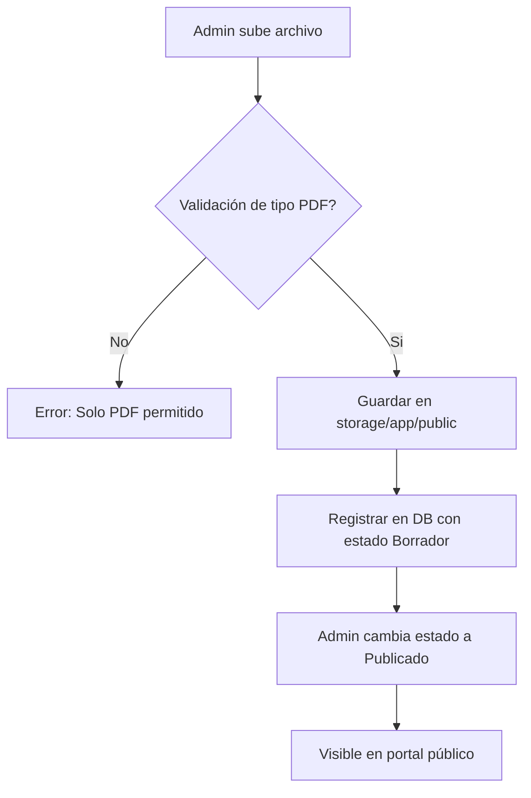

# Planeader (Portal de Planeación para el Desarrollo)

Sistema web del Portal de Planeación para el Desarrollo del Estado de Puebla, construido con Laravel 12. Facilita la consulta y gestión de planes de desarrollo (estatales y municipales), programas derivados, subcomités y documentos metodológicos, integrando un panel administrativo robusto con control de acceso por roles y permisos.

## 1. Objetivo del proyecto

Este proyecto centraliza la información estratégica de planeación del estado de Puebla:

1. **Sitio público:** Para la transparencia y consulta ciudadana de planes estatales, municipales, programas derivados e información de COPLADEP y COPLADEMUN.
2. **Panel privado:** Para la administración descentralizada de contenidos, documentos institucionales, usuarios y roles.

La aplicación permite:
- Visualizar el Plan Estatal de Desarrollo (PED) y sus anexos.
- Gestionar y consultar Planes Municipales de Desarrollo mediante un mapa interactivo (Regionalización).
- Administrar el Consejo de Planeación para el Desarrollo (COPLADEP) y comités municipales (COPLADEMUN).
- Publicar documentos metodológicos, herramientas de planeación y marco jurídico.
- Registrar capacitaciones municipales y gestionar el historial de sesiones.
- Realizar encuestas de satisfacción y captar mensajes de contacto.

## 2. Stack tecnológico

- PHP `^8.2`
- Laravel `^12.0`
- Laravel Jetstream `^5.5` (Livewire stack)
- Livewire `^3.3`
- MySQL / MariaDB
- Spatie `laravel-permission` para roles y permisos
- Laravel Mix `^6`
- Bootstrap `^5.1`
- Alpine.js (integrado con Livewire)

## 3. Arquitectura general

La aplicación está dividida en capas funcionales:

- **Capa pública:** Muestra planes, programas, documentos descargables y herramientas de consulta.
- **Capa administrativa:** Panel bajo `/dashboard` para CRUD de catálogos, documentos y configuración.
- **Capa de persistencia:** MySQL/MariaDB + almacenamiento en `storage/app/public`.

### Módulos principales

| Módulo | Tipo | Responsable | Función |
|---|---|---|---|
| Inicio | Público | `InicioController` | Banners de inicio y secciones institucionales |
| PED | Público | `PlanEstatalController` | Muestra el Plan Estatal de Desarrollo y anexos |
| Programas | Público | `ProgramaDerivadoController` | Consulta de programas derivados del PED |
| Planes Municipales| Público | `PlanMunicipalController` | Mapa interactivo y descarga de planes locales |
| Subcomités | Público | `SubcomiteController` | Información y documentos de subcomités sectoriales |
| COPLADEP | Público | `DocumentoCopladepController`| Sesiones y documentos del consejo estatal |
| COPLADEMUN | Público | `DocumentoApoyoCoplademunController` | Apoyo técnico para comités municipales |
| Regionalización | Público | `InicioController` | Mapeo por microrregiones y macrorregiones |
| Marco Jurídico | Público | `MarcoJuridicoController` | Repositorio legal (PDFs y enlaces) |
| Dashboard | Privado | `DashboardController` | Resumen operativo para administradores |
| Usuarios | Privado | `AdminUserController` | Gestión de cuentas de usuario |
| Roles | Privado | `RoleController` | Configuración de roles y permisos de Spatie |

## 4. Estructura funcional del sitio

### Rutas web públicas

- `/` -> Inicio
- `/ped` -> Plan Estatal de Desarrollo
- `/ped-programas` -> Programas derivados
- `/subcomites` -> Directorio y detalle de subcomités
- `/planesmunicipales` -> Consulta de planes locales
- `/regionalizacion` -> Herramienta de mapeo regional
- `/marcojuridico` -> Sección legal
- `/capacitacion-municipal` -> Listado de capacitaciones

### Rutas administrativas

Bajo el middleware `auth`, todas las rutas de gestión usan el prefijo `panel-`:

- `/dashboard` -> Resumen administrativo
- `/panel-planes-estatales`
- `/panel-planes-municipales`
- `/panel-programas-derivados`
- `/panel-subcomites`
- `/panel-documentos-copladep`
- `/panel-admin` (Usuarios)

## 5. Flujo funcional por módulo

### 5.1 Planes Municipales (Mapa)
Archivos: `PlanMunicipalController`, `CatMunicipio`, `regionalizacion.blade.php`.
Acción: Mediante un mapa interactivo (o selectores), el usuario selecciona un municipio para obtener su PMD (PDF) y ficha técnica.
Regla: Los planes deben estar marcados como "Publicados" para aparecer en el sitio público.

### 5.2 Almacenamiento Dinámico
El sistema gestiona archivos vinculados a modelos específicos.
- Los documentos de subcomités se guardan en `storage/app/public/documentos_subcomites`.
- Los planes se guardan en `storage/app/public/planes_municipales`.

### 5.3 Control de Acceso (RBAC)
Usa Spatie Permissions con los siguientes roles base:
- `super-admin`: Acceso total.
- `admin`: Gestión de contenidos.
- `editor`: Puede crear y editar pero no borrar (según configuración de seeder).
- `consultor`: Solo lectura.

## 6. Gráficos de decisión

### 6.1 Publicación de Documentos


## 7. Modelo de datos (Tablas principales)

| Tabla | Descripción |
|---|---|
| `users` | Usuarios y perfiles |
| `planes_estatales` | Datos del PED |
| `planes_municipales`| Datos de planes locales |
| `subcomites` | Estructura de subcomités |
| `cat_municipios` | Catálogo geográfico de Puebla |

## 8. Almacenamiento de archivos

Es CRÍTICO ejecutar:
```bash
php artisan storage:link
```
Esto habilita la descarga de documentos desde `public/storage`.

## 9. Guía de Inicio Rápido (Developer Onboarding)

### Prerrequisitos
- PHP `>= 8.2`
- MySQL / MariaDB `>= 8.0`
- Composer `>= 2.x`
- Node.js `>= 18.x` & NPM

### Pasos para desplegar en entorno local

1. **Clonar repositorio e instalar dependencias de PHP:**
   ```bash
   git clone <URL_DEL_REPOSITORIO>
   cd planeader
   composer install
   ```

2. **Instalar dependencias frontend:**
   ```bash
   npm install
   ```

3. **Configurar archivo de entorno `.env`:**
   ```bash
   cp .env.example .env
   php artisan key:generate
   ```
   *Asegúrate de ajustar los parámetros de conexión a tu base de datos local en el archivo `.env` (`DB_DATABASE`, `DB_USERNAME`, `DB_PASSWORD`).*

4. **Ejecutar migraciones y datos iniciales (seeders):**
   ```bash
   php artisan migrate --seed
   ```

5. **Enlazar almacenamiento público:**
   ```bash
   php artisan storage:link
   ```

6. **Compilar recursos estáticos o iniciar servidor de desarrollo:**
   ```bash
   # Compilación frontend
   npm run dev

   # En otra consola, iniciar servidor Laravel
   php artisan serve
   ```

### Comandos útiles de mantenimiento
- **Limpiar caché del sistema:** `php artisan optimize:clear`
- **Revisar mapa de rutas:** `php artisan route:list`

---
*Este portal es una herramienta clave para el seguimiento de la planeación democrática en el Estado de Puebla.*
